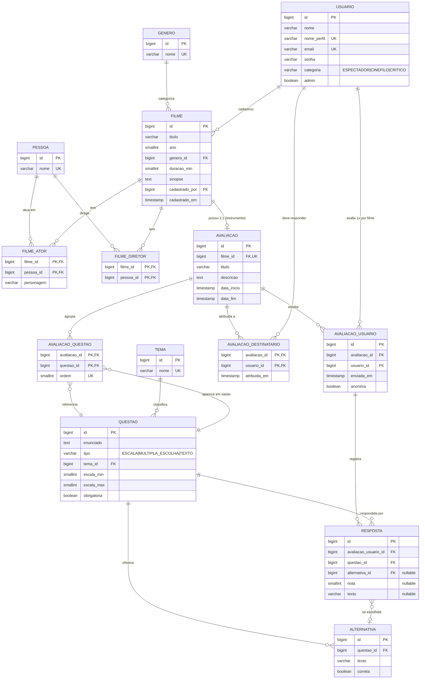
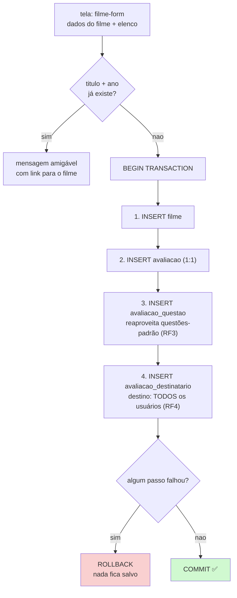
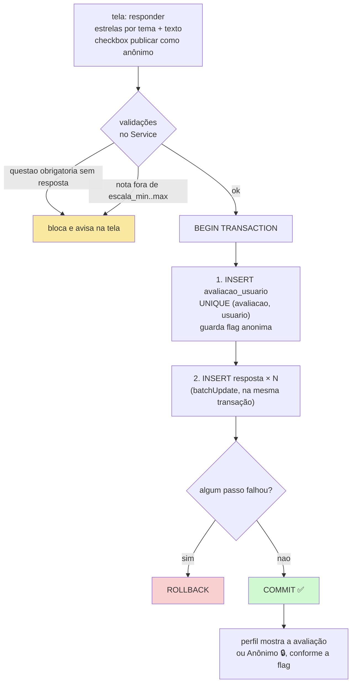
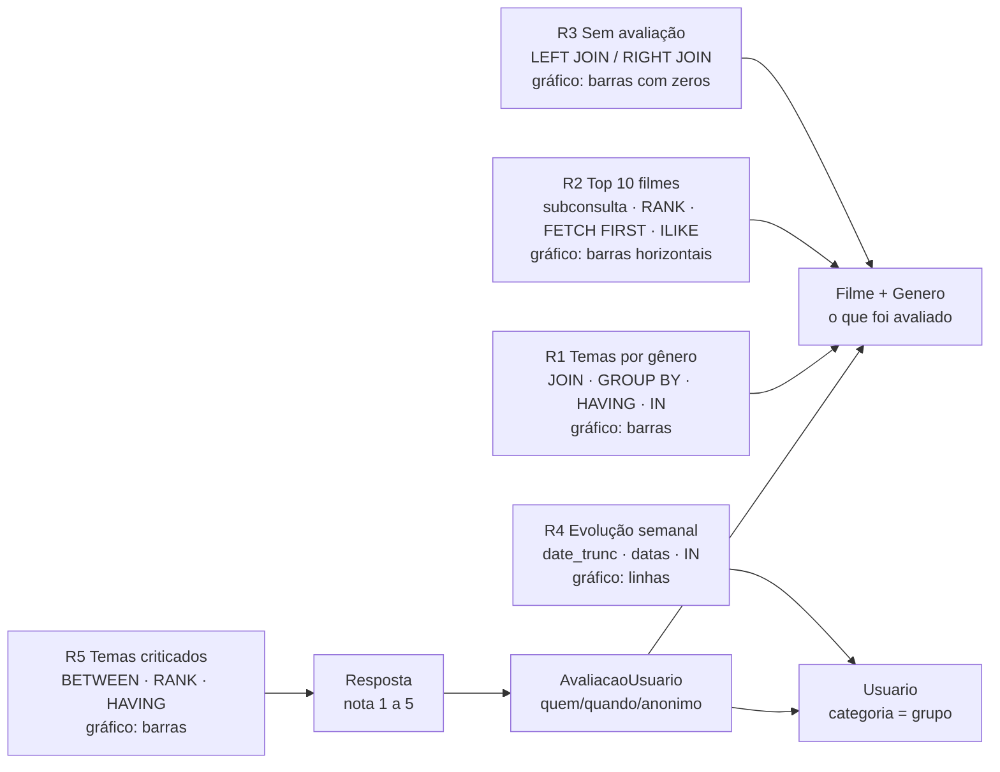

# Central do Brasil — Visualização do Banco (Mermaid)

Como visualizar:
- **VS Code**: instalar a extensão "Markdown Preview Mermaid Support" e abrir o preview (`cmd+shift+V`).
- **GitHub**: o GitHub renderiza Mermaid nativamente em qualquer `.md`.
- **Online**: colar o código em https://mermaid.live

---

## 1. DER — Esquema Relacional

> Restrições importantes do schema:
> - `FILME`: `UNIQUE (titulo, ano)` — não tem filme duplicado
> - `AVALIACAO_USUARIO`: `UNIQUE (avaliacao_id, usuario_id)` — cada usuário avalia cada filme **uma vez**
> - `RESPOSTA`: `CHECK` exatamente um dos três campos preenchido (nota **ou** alternativa **ou** texto)

---

## 2. Fluxo A — Cadastro de filme (1 transação, 4 tabelas)

---

## 3. Fluxo B — Usuário avalia o filme (1 transação, 2 tabelas)

---

## 4. Fluxo C — Leitura dos relatórios (RF7)

| Relatório | Perspectiva | Recursos SQL |
|---|---|---|
| R1 | Tema × gênero do filme | JOIN, GROUP BY/HAVING, IN |
| R2 | Ranking de filmes | subconsulta, RANK(), FETCH FIRST, ILIKE |
| R3 | Filmes/questões ausentes | LEFT JOIN, RIGHT JOIN |
| R4 | Períodos e grupos | date_trunc, filtro de datas, IN |
| R5 | Aspectos mais criticados | BETWEEN, RANK(), HAVING |
